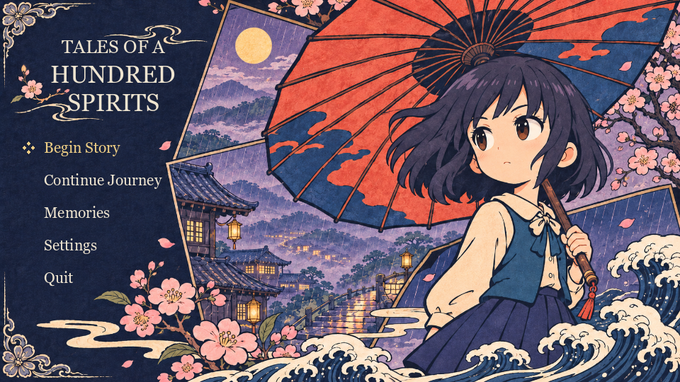
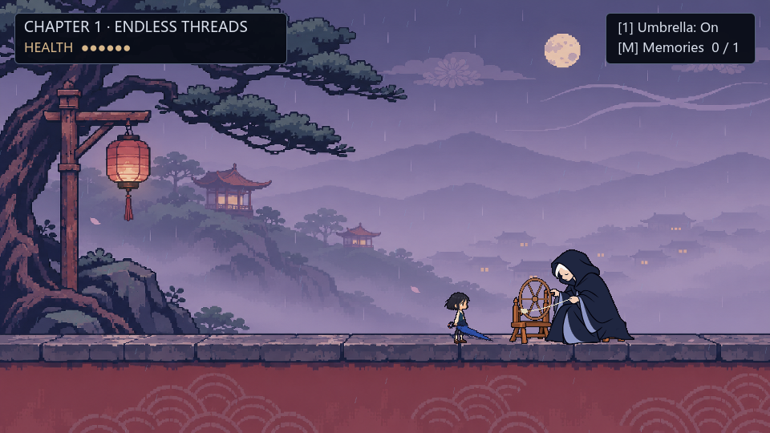
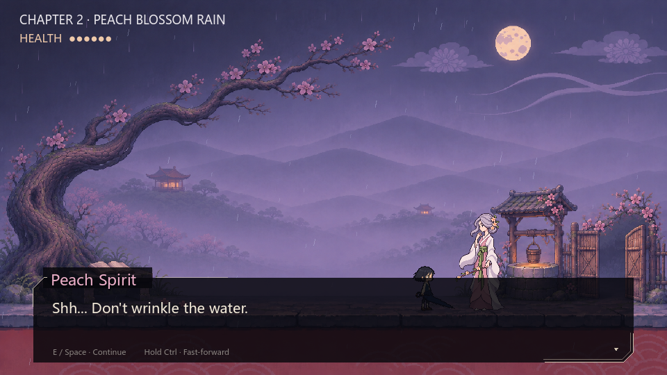
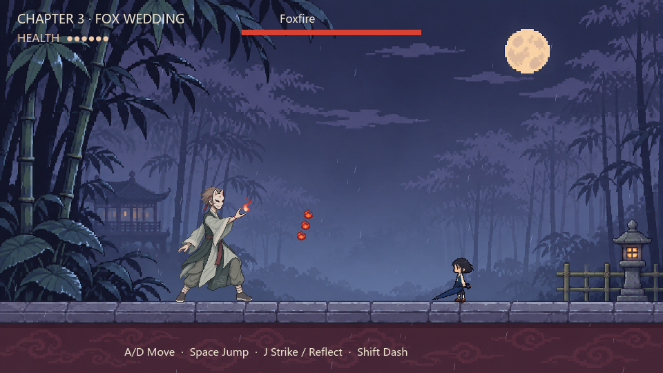
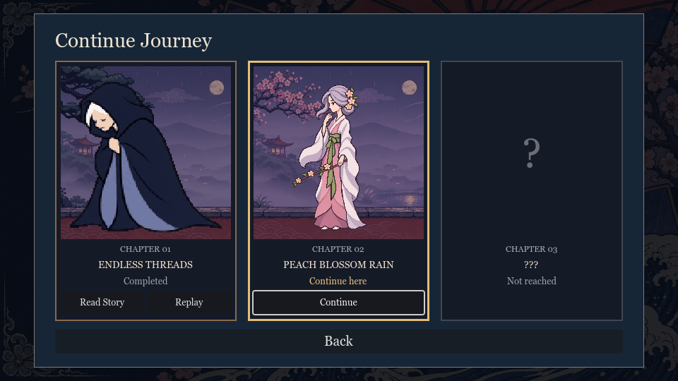

# Tales of a Hundred Spirits

A story-driven 2D action adventure about Xiaoyu, a girl with an umbrella, and the spirits she meets in the rain. Fight through tangled memories, listen to the people behind the monsters, and keep their stories in a friend journal.

Built with **Godot 4.7**. This is a playable work in progress with three chapters, illustrated environments, pixel-style characters, and a growing collection of encounters.



## A journey through the rain

### Chapter One — Endless Threads

A lantern-lit mountain town, a spinning wheel, and a grandmother whose threads will not let go. Face her silk attacks with Xiaoyu's umbrella, then discover the memory beneath her cloak.



### Chapter Two — Peach Blossom Rain

An old well stands beneath a flowering tree. The Peach Spirit watches the water, waiting for someone whose reflection she remembers. Umbrella combat gives way to a quieter conversation.



### Chapter Three — The Fox Wedding

Enter a moonlit bamboo grove and meet Qingyan. Time umbrella strikes to reflect foxfire, and watch the ground for incoming flames. This chapter's narrative is still being developed.



## Stories worth returning to

- **Continue Journey** opens a chapter gallery. The next chapter is highlighted, completed chapters can be replayed, and later encounters remain hidden.
- **Memories** records the spirit friends you have met. Completing an encounter unlocks its story and recorded conversations where available.
- Progress is saved on victory. Reading or replaying an earlier chapter keeps your furthest progress.
- Rain continues through dialogue and combat, with layered scenery, animated footsteps, and umbrella impact sounds.
- Settings include mute, fullscreen, and reduced screen shake.



## Play locally

Install Godot 4.7 and [Git LFS](https://git-lfs.com/) before cloning. From your clone:

```sh
git lfs install
git lfs pull
godot --editor --path .
```

You can also import `project.godot` through Godot's Project Manager. Let the initial asset import finish, then press **F5**. To launch directly:

```sh
godot --path .
```

The game uses a 960 × 540 base viewport that scales with the window. The first two chapters have English dialogue; Chapter Three currently includes a Chinese opening draft with an English combat HUD.

## Controls

| Action | Keyboard |
| --- | --- |
| Move | A / D or Left / Right |
| Jump | Space |
| Umbrella strike / reflect foxfire | J |
| Upward strike | W / Up + J |
| Dash | Shift or K |
| Equip / put away umbrella | 1 |
| Talk / advance dialogue | E / Space |
| Fast-forward dialogue | Hold Ctrl |
| Pause / back | Esc |
| Return to main menu while paused | Q |
| Open chapter memories | M |

After Chapter One's closing conversation, walk to the right edge to enter the next chapter.

## Repository and assets

```text
assets/       Artwork, animation frames, audio, fonts, and asset notes
scenes/       Menu and introduction scenes
scripts/      Gameplay, dialogue, UI, persistence, and verification scripts
tools/        Asset preparation and audio synthesis tools
docs/         Selected screenshots for this page
chapter*.tscn Chapter entry scenes
```

Game images, audio, and fonts are tracked with **Git LFS**. Git stores small pointers in its history and uploads changed binary objects separately, avoiding repeated large blobs in ordinary commits. The initial clone or push still transfers the assets once. Keep LFS enabled when contributing; a remote with LFS support is required.

Godot's `.godot/` cache, local exports, Python caches, backups, and bulk `art_review/` captures are excluded. The curated screenshots in this README are stored in ordinary Git so repository previews work without fetching LFS objects. Commit source assets and their Godot `.import` settings together.

Save data lives in Godot's `user://` directory. Journey saves use a versioned format, temporary writes, and a previous-save backup, with compatibility for older chapter memory flags.

## Verification

The project includes scripted checks for menus, chapter progression, the friend journal, dialogue, movement, footsteps, rain, and combat. Tests that write saves must use an isolated environment. In a separate PowerShell process, run:

```powershell
$testRoot = Join-Path $PWD '.godot/test_environment'
$env:APPDATA = Join-Path $testRoot 'roaming'
$env:LOCALAPPDATA = Join-Path $testRoot 'local'
$env:TALES_TEST_RUN = '1'
New-Item -ItemType Directory -Force -Path $env:APPDATA,$env:LOCALAPPDATA | Out-Null
godot --headless --path . --script res://scripts/verify_friend_journal.gd
godot --headless --path . --script res://scripts/verify_english_menu.gd
```

Run without `--headless` when you need visual captures. Test captures are written to the ignored `art_review/` directory.

Asset preparation and generation notes are kept alongside their corresponding files under `assets/`. This repository does not currently declare a redistribution license.
